# Interactive Tall Grass Lab

[日本語](README.md) | **English**

A browser demo of top-down pixel-art tall grass that reacts when you walk through it.
Tufts lean away from your feet and spring back. They flatten when you step on them, then grow back. A rustle shakes them and throws leaf specks. Tufts in front of the character hide its legs.

### ▶ [Play in your browser (GitHub Pages)](https://kumi0708.github.io/2d-interactive-grass-lab/?lang=en)

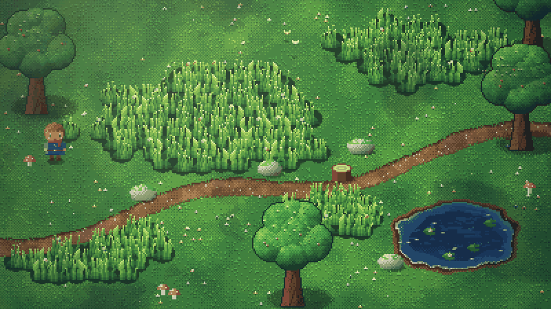

Based on the article [How to make interactive tall grass for a top-down pixel art game (SpriteCook)](https://www.spritecook.ai/blog/interactive-tall-grass-top-down-pixel-art).
The article targets Godot 4.6. This repo ports it to **plain JavaScript + Canvas 2D** and generates all the art from code: no image assets and no build step.

---

## Contents

- [Controls](#controls)
- [How it fits together](#how-it-fits-together)
- [1. Every tuft is its own sprite](#1-every-tuft-is-its-own-sprite)
- [2. Y-sort and sortOffset](#2-y-sort-and-sortoffset)
- [3. Lean away (spring)](#3-lean-away-spring)
- [4. Bending by row shift](#4-bending-by-row-shift)
- [5. Trample, then grow back](#5-trample-then-grow-back)
- [6. Cover](#6-cover)
- [7. Rustle and cooldown](#7-rustle-and-cooldown)
- [8. The wading cut](#8-the-wading-cut)
- [9. Look cache](#9-look-cache)
- [10. Wind (an extension in this repo)](#10-wind-an-extension-in-this-repo)
- [11. Software renderer and lighting](#11-software-renderer-and-lighting)
- [12. Procedural art](#12-procedural-art)
- [Parameters](#parameters)
- [Checks against the article](#checks-against-the-article)
- [Files](#files)
- [Run locally](#run-locally)

---

## Controls

| Input | Action |
| --- | --- |
| `WASD` / arrow keys | Move |
| Click / tap (drag works too) | Walk to that point (works on phones) |
| `G` | Grass reaction on/off |
| `C` | Wading cut on/off |
| `V` | Wind on/off |
| `F` | Light & FX (cloud shadows, sunlight, butterflies, pollen…) |
| `B` | Debug view (zones, lean vectors, sort line) |
| `M` | Magnifier (live zoom of the wading cut) |
| `P` | Parameter panel (sliders for spring, trample, rustle, wind) |

URL parameters also work, for example [`?debug=1&magnify=1`](https://kumi0708.github.io/2d-interactive-grass-lab/?debug=1&magnify=1&lang=en), `?lang=ja`, and `?wind=0`.

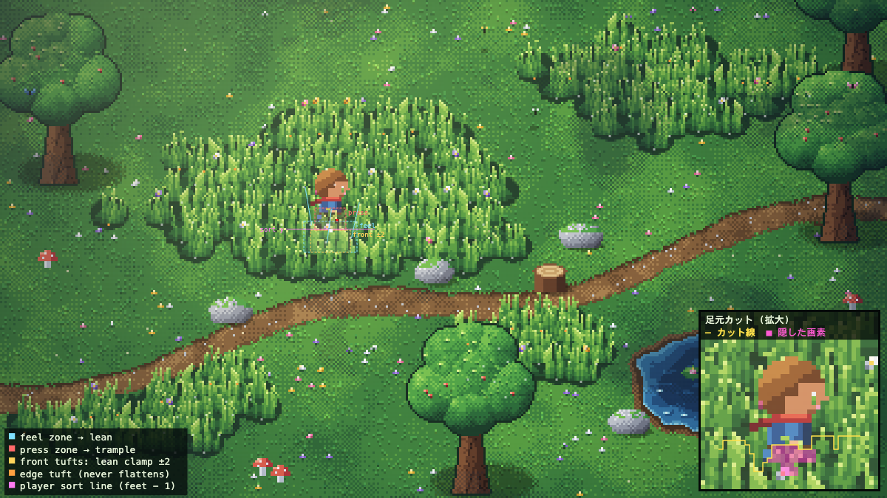

---

## How it fits together

Everything runs on the CPU, with no shaders. Physics runs on a **fixed 60 Hz tick**. Rendering runs on every `requestAnimationFrame`.

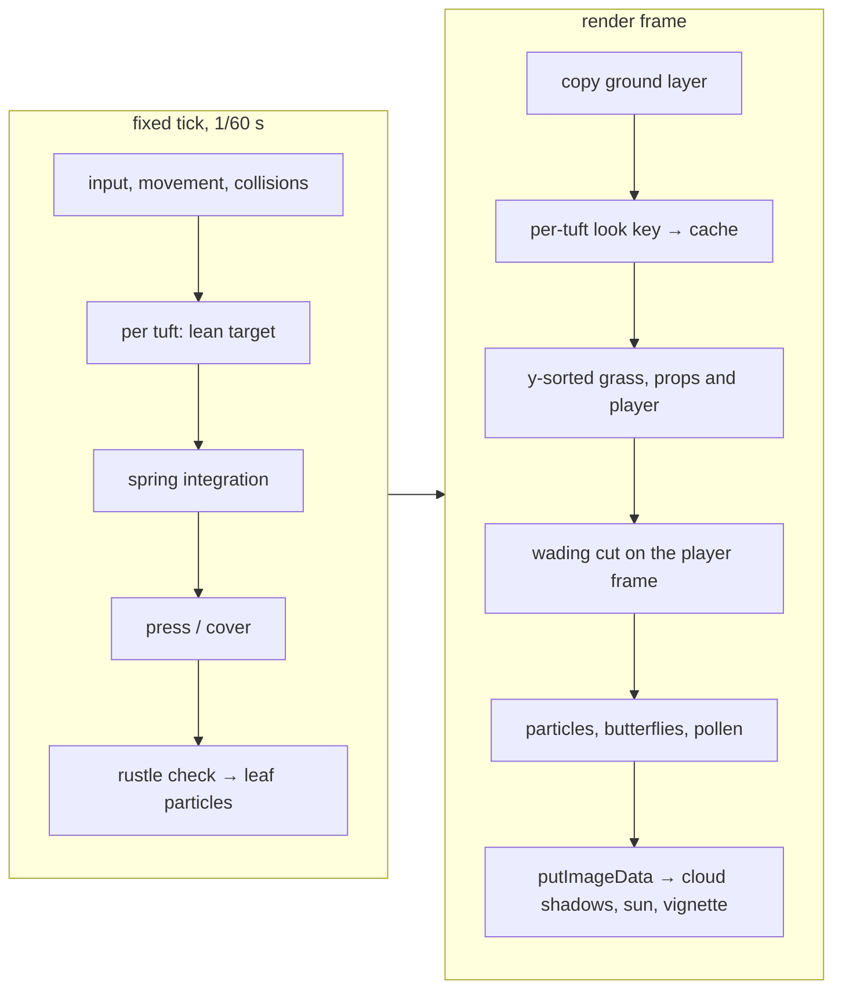

| Stage | File |
| --- | --- |
| Grass simulation and look building | [`src/grass.js`](src/grass.js) |
| Tuft art | [`src/tufts.js`](src/tufts.js) |
| Wading cut | [`src/wade.js`](src/wade.js) |
| Game loop, y-sort, compositing | [`src/game.js`](src/game.js) |

---

## 1. Every tuft is its own sprite

The grass patch is not one picture. It is a set of **16×18 px tuft sprites**, each with its origin at its base.

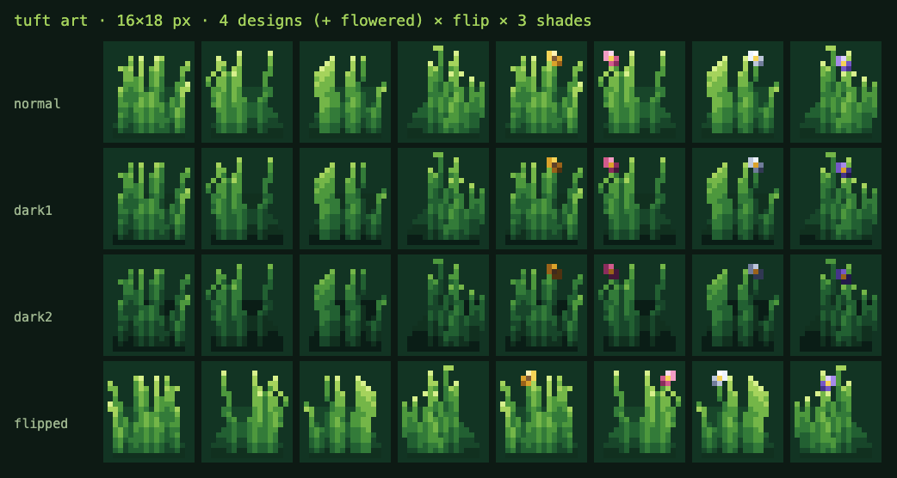

- **4 designs** (plus 4 flowered variants) × **horizontal flip** × **3 shades** (normal, dark1, dark2).
- Every pixel is painted as an index into a colour ramp (an ordered list of colours from dark to light). So **dark1 and dark2 just step each pixel 1 or 2 levels down its ramp** (`darkenCode`).
- The **lower 10 rows are filled solid, with no holes**, so the patch does not look sparse through the gaps.
- The ground under a patch is **one flat dark green**, so the gaps between tufts read as depth. This repo paints that ground from the tuft positions, so it sits right under the tuft bodies.
- Tufts sit on a **staggered grid of about 13 × 8 px**, with some jitter.
- **Edge tufts**, which have open ground behind them, are flagged at layout time and never flatten. Flattening one would show the meadow behind it.

Each blade is drawn as a curve from base to tip ([`src/tufts.js`](src/tufts.js)). Blades are darker at the base and brighter toward the tip. The left edge is one level lighter, as if lit from the upper left. Blades are layered from back to front.

---

## 2. Y-sort and sortOffset

Tufts, trees, rocks, and the player are sorted by their **base y** and drawn back to front.

- The player sorts as if his feet were **1 px higher** (`sortOffset = 1`). A tuft whose base is level with his feet therefore draws in front of him.
- On a tie, the player draws last (in front).
- Tufts and props never move, so they are sorted once. Each frame only finds where the player goes in that list.

Y-sort alone still **shows the legs through the gaps between the front tufts**. The [wading cut](#8-the-wading-cut) fixes that.

---

## 3. Lean away (spring)

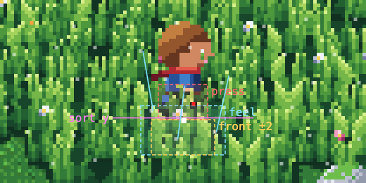

Each tick, take `dx = tuft.x − feet.x` and `dy = tuft.y − feet.y`.

**Feel zone** (cyan): `|dx| < 12` and `−4 < dy < 10`

```js
// Pick the lean direction when the tuft enters the zone; break ties with the tuft's random phase
if (t.side === 0) t.side = dx > 0 ? 1 : dx < 0 ? -1 : t.phase > 0.5 ? 1 : -1;
target = side * 7 * min(1, (12 - |dx|) / 6) * min(1, (10 - |dy - 3|) / 5);
// Tufts in front (yellow) lean at most ±2 px, so they keep covering the legs
if (dy > -1 && |dx| < 9) target = clamp(target, -2, 2);
```

- `side` resets **when the tuft leaves the zone**, so the direction never flips while he walks past.
- The lean follows a **damped spring**, integrated with semi-implicit Euler:

```js
const w = 2 * Math.PI * 2.6;                              // 2.6 Hz
const acc = w * w * (target - lean) - 2 * 0.22 * w * vel; // damping ratio 0.22
vel  += acc * dt;
lean  = clamp(lean + vel * dt, -8, 8);
```

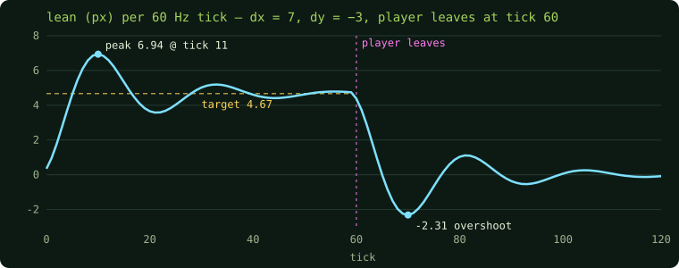

The damping is light (0.22). A tuft swings past its target, and when he leaves it bounces to the other side before it settles. That bounce gives the grass its springy feel. [`tools/plot.mjs`](tools/plot.mjs) draws this chart by running the real `tickGrass()`.

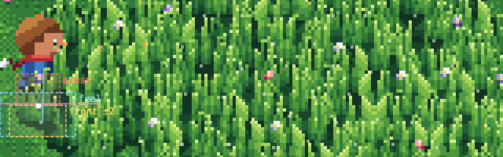

---

## 4. Bending by row shift

A lean is not a rotation. Each row of the sprite **slides sideways by a whole number of pixels**:

```js
shift(r) = round(total * ((h - 1 - r) / (h - 1)) ** 1.6)   // r = 0 is the tip, h-1 is the base
```

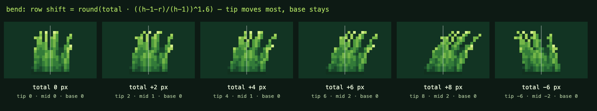

- With the 1.6 exponent, **the tip moves most and the base stays put**.
- Every shift rounds to a whole pixel, so the art stays crisp, with no blur.
- `total = lean + shake + wind`. If `|total| < 0.5`, no shift is applied, so tufts at rest do not flicker.
- The output image gets `pad = ceil(|total|) + 1` px of padding on each side, and the draw position moves to match.

---

## 5. Trample, then grow back

**Press zone** (red): `|dx| < 7` and `−10 < dy ≤ −1`, which covers the tufts under his body. Edge tufts are left out.

```js
press += inZone ? dt / 0.12 : -dt / 0.7;    // flat in 0.12 s, back in 0.7 s
h  = max(1, round(18 * (1 - 0.67 * smoothstep(press)) * (1 - 0.1 * cover)));
shade = press > 0.6 ? dark2 : press > 0.3 ? dark1 : normal;
```

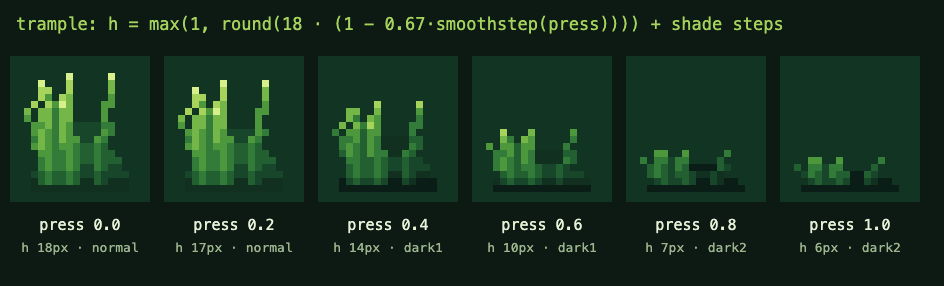

- The height drops from 18 px to 6 px. Rows are **resampled** with `src = round(i * (18 - 1) / (h - 1))`, which always keeps the base row.
- The more a tuft is pressed, the darker the shade it uses, so it looks shadowed.
- Regrowth takes **under a second**, so dark trails never pile up.

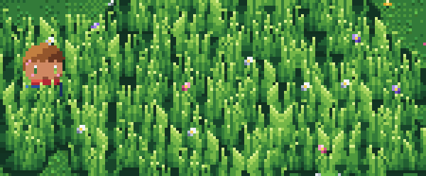

---

## 6. Cover

Tufts just in front of his feet get up to 10% shorter, so they do not hide too much of his face and body.

```js
ddy  = dy + 1;
near = ddy > 0 ? clamp((11 - |dx|) / 3, 0, 1) * clamp((10 - ddy) / 3, 0, 1) * min(1, ddy / 3) : 0;
cover → near   // changes by at most 1/0.35 per second
```

---

## 7. Rustle and cooldown

When the lean target goes over `1.5 px` and the last rustle was more than `0.7 s` ago, the tuft **rustles**.

```js
shake = 1.3 * sin(age * 55 + phase * 6) * max(0, 1 - age / 0.35);   // age = now - touch
```

- The tuft shivers for 0.35 s and throws pale leaf specks (`Particles.rustle` in [`src/fx.js`](src/fx.js)).
- While he keeps pushing, `touch = max(touch, now − 0.5)` **keeps extending the cooldown**. Standing still in the grass does not keep firing shakes or particles.

---

## 8. The wading cut

Y-sort alone shows his legs through the **gaps** between front tufts. So every frame, his current 32×32 animation frame is cut:

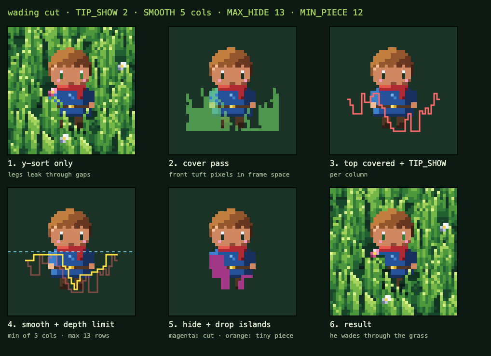

1. **Cover pass**: take every tuft sorted in front of him (base y > feet − 1). Mark each opaque pixel of its **current drawn image** in his frame's coordinates.
2. **Top per column**: `cut[c]` = the top-most marked row in column `c`, plus `TIP_SHOW = 2`. The 2 rows under the blade tips stay visible, so the tips appear to overlap his body.
3. **Smoothing**: take the minimum over columns `c−2 … c+2`, mirror-indexed at the edges. This keeps the cut line from looking jagged.
4. **Depth limit**: never hide more than `MAX_HIDE = 13` rows above his lowest opaque row. This stops sparse grass from hiding his whole body.
5. **Hide and drop islands**: hide every row at or below `cut[c]`. Then flood-fill what is left (8-connected) and drop any piece under `MIN_PIECE = 12` px, such as a few leg pixels showing through a gap.

The cut comes from the **grass as it is drawn right now**. It moves when tufts lean or flatten.

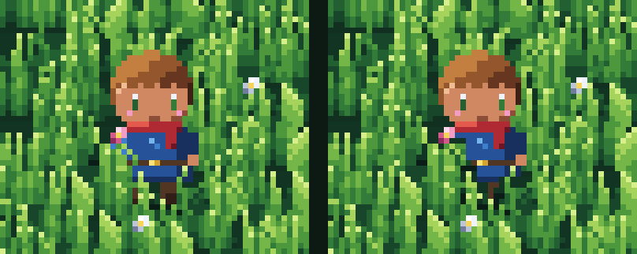

Left: wading cut off (y-sort only), so his legs show through the gaps. Right: wading cut on, so he wades through the grass.

> Code: [`src/wade.js`](src/wade.js). Press `M` in game to open the magnifier. It shows the cut line (yellow) and the hidden pixels (magenta) live.

---

## 9. Look cache

The article's Godot version gives each tuft a look key of `"width,height,hash(image data)"`. It uploads a new texture only when that key changes.

This repo goes one step further with **one cache shared by all tufts**:

```js
key = artId * 100000 + h * 1000 + (total * 4 + 500)   // artId = design × flip × shade
```

- A look depends only on the art, the height, and the bend (quantised to 0.25 px). **Tufts in the same state share one image.**
- With about 170 tufts swaying in the wind, only a few hundred unique images exist. A tuft at rest costs nothing to rebuild.
- The status bar shows `looks cached` (cache size) and `built this frame` (images built this frame).

---

## 10. Wind (an extension in this repo)

The article has no wind. This repo adds a wind term to the row-shift `total`, which gives a slow sway plus **gust bands that travel across the field**:

```js
sway = 0.55 * sin(t * 1.4 + x * 0.045 + y * 0.021);
gust = max(0, sin(x * 0.022 + y * 0.012 - t * 0.9)) ** 6 * 1.9;
wind = windPx * (sway + gust) * (1 - smoothstep(press));   // flattened tufts don't sway
```

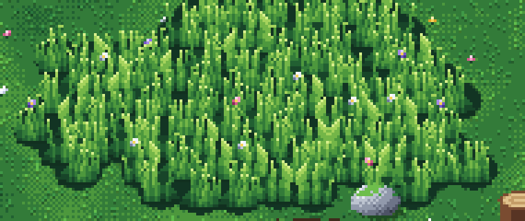

Wind uses the same row shift and cache, so it adds almost no cost.

---

## 11. Software renderer and lighting

- The screen is a **400×225 `Uint32Array` framebuffer**. Each frame copies the ground, blits the sprites, and calls `putImageData` once. It uses almost none of the Canvas drawing API.
- The canvas is scaled up by a whole number (`image-rendering: pixelated`) so the pixels stay sharp. On small screens such as phones it scales below 1×.
- Canvas 2D then draws light layers on top (toggle with `F`):
  - **Drifting cloud shadows** (fbm noise with two alpha steps and a checkerboard dither)
  - **Warm sunlight** from the upper left, and a **vignette**
- The scene also has water glints, butterflies that flee when he comes close, falling leaves from the trees, drifting pollen, and dust puffs on the dirt path.
- Shadows (trees, rocks, player, butterflies) darken the colours inside an ellipse. The edge is softened with a **4×4 Bayer ordered dither**.

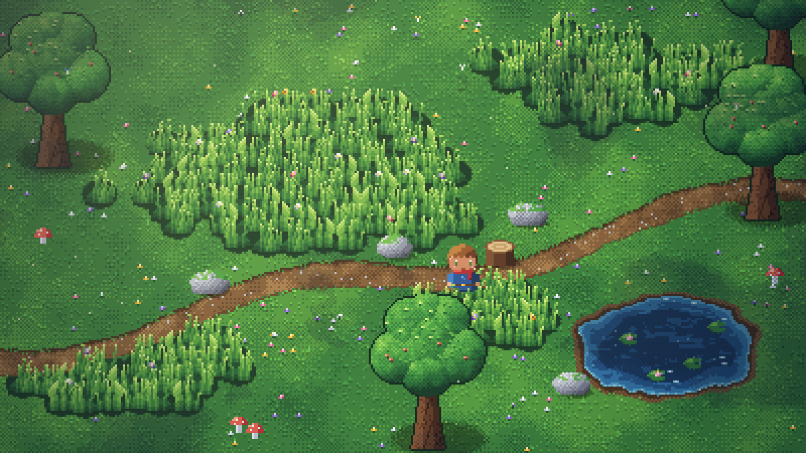

---

## 12. Procedural art

No image files are used. Everything comes from seeded random numbers and noise, so the scene looks the same on every load.

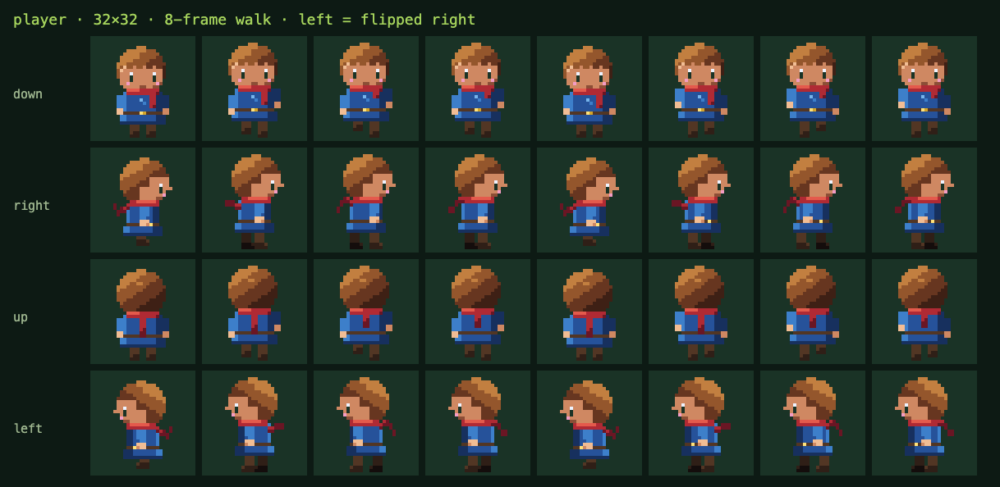

| Asset | How it is made |
| --- | --- |
| Tufts | Curved blades layered back to front, shaded with ramp indices, lower 10 rows filled, optional flower |
| Player | 32×32 px. Down, up, and right × 8 walk frames plus idle. Left is the flipped right. A 1 px outer outline is added automatically |
| Trees | Union of shaded spheres, with Lambert lighting plus noise and dithered shading, a shadowed underside, apples, and leaf highlights |
| Ground | Three meadow colour levels from fbm noise plus dither, with short blade marks, clover, and flowers. Also the dirt path, the pond (colour by depth, foam on the shore), and lily pads |
| Rocks, stump, mushrooms | Sphere lighting, moss, and an outline |

---

## Parameters

You can change these while the game runs, in the panel opened with `P`. Values match the article.

| Name | Default | Meaning |
| --- | --- | --- |
| `feelX / feelBack / feelFront` | 12 / 4 / 10 | Feel zone (px) |
| `leanPx` | 7 | Maximum lean target |
| `frontX / frontLeanPx` | 9 / 2 | Range and limit of the front-tuft lean clamp |
| `maxLeanPx` | 8 | Hard limit on lean |
| `springHz / damping` | 2.6 / 0.22 | Spring frequency and damping ratio |
| `pressX / pressBack` | 7 / 10 | Press zone |
| `pressTime / recoverTime` | 0.12 / 0.7 | Time to flatten and time to recover (s) |
| `pressSquash` | 0.67 | How much a flattened tuft shrinks |
| `coverTime / coverSquash` | 0.35 / 0.1 | Cover rate and how much it shrinks |
| `shakePx / shakeSpeed / shakeTime` | 1.3 / 55 / 0.35 | Rustle shake size, speed, and length |
| `touchLean / touchCooldown` | 1.5 / 0.7 | Lean needed to rustle, and the cooldown |
| `sortOffset` | 1 | Player sort offset |
| `windPx / windSpeed` | 1.0 / 1.0 | **Extension**: wind strength and speed |
| `TIP_SHOW / SMOOTH_COLUMNS / MAX_HIDE / MIN_PIECE` | 2 / 5 / 13 / 12 | Wading cut constants |

---

## Checks against the article

[`tools/verify.mjs`](tools/verify.mjs) reruns the article's tick-count checks in Node (`npm run verify`):

```
PASS  lean peak ~6.9 px @ tick 11                  peak=6.94 @11
PASS  settles within 0.5 of 4.67 from tick 35      settle=35
PASS  overshoot ~-2.3 px after leaving             min=-2.27
PASS  back within 0.5 of 0 from tick 36 (±1)       back=35
PASS  fully flat (6 px) on tick 8 (±1)             flat=7
PASS  back to 18 px on tick 37                     grown=37
PASS  press = 0 on tick 42                         zero=42
```

Two checks land one tick early. The likely reason is that the article counts the tick on which the new image appears, which can trail the physics tick by one.

---

## Files

```
index.html, style.css     UI (Japanese / English, toggles, parameter panel)
src/main.js               input, loop, UI, deterministic stepping API (window.lab)
src/game.js               game state, movement, y-sort, frame compositing
src/grass.js              ★ grass physics (lean, press, cover, rustle) + look cache
src/wade.js               ★ wading cut
src/tufts.js              tuft art (design × flip × shade)
src/player.js             player walk cycles
src/world.js              ground, patches, tuft layout, trees/rocks/props, collisions
src/fx.js                 particles, butterflies, water, pollen, light layers
src/raster.js             framebuffer blits, shadows, outlines
src/palette.js            colour ramps
src/debug.js              debug overlay and magnifier
src/figures.js            README figures (?fig=tufts|bend|trample|player|cut)
tools/verify.mjs          checks against the article's numbers
tools/capture.mjs         regenerates the README images and GIFs (headless Chrome)
tools/plot.mjs            spring response chart (SVG)
```

Every figure and GIF in this README is generated from the same code as the game. None are drawn by hand.

---

## Run locally

There is no build step. The code uses ES modules, so serve the folder with any static server:

```bash
python3 -m http.server 8765
```

Then open http://localhost:8765/.

To regenerate the README images (needs Google Chrome and Python Pillow):

```bash
npm install
```

```bash
npm run capture
```

## Credits

- Technique: [SpriteCook — How to make interactive tall grass for a top-down pixel art game](https://www.spritecook.ai/blog/interactive-tall-grass-top-down-pixel-art). The numbers and algorithms follow the article. The JavaScript is written from scratch.
- All art is generated by the code in this repo.
