# Interactive Tall Grass Lab

**日本語** | [English](README.en.md)

見下ろし型ピクセルアートの「歩くと反応する背の高い草むら」を、ブラウザだけで動くように実装したデモです。
草は足から押しのけられるように傾き、ばねで戻り、踏まれると潰れて、また伸びます。触れるとカサカサ揺れて葉が舞い、手前の草はキャラクターの脚をちゃんと隠します。

### ▶ [ブラウザで遊ぶ (GitHub Pages)](https://kumi0708.github.io/2d-interactive-grass-lab/)

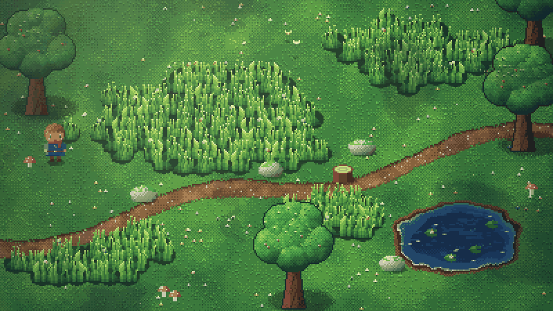

元になった技術記事: [How to make interactive tall grass for a top-down pixel art game (SpriteCook)](https://www.spritecook.ai/blog/interactive-tall-grass-top-down-pixel-art)。
記事は Godot 4.6 向けですが、ここでは **素の JavaScript + Canvas 2D** に移植し、絵はすべてコードで生成しています（外部画像アセットなし、ビルド不要）。

---

## 目次

- [操作方法](#操作方法)
- [全体の仕組み](#全体の仕組み)
- [1. 1株 = 1スプライト](#1-1株--1スプライト)
- [2. Yソートと sortOffset](#2-yソートと-sortoffset)
- [3. 押しのけて傾く（ばね）](#3-押しのけて傾くばね)
- [4. 行シフトで曲げる](#4-行シフトで曲げる)
- [5. 踏まれて潰れ、また伸びる](#5-踏まれて潰れまた伸びる)
- [6. カバー（顔の前の草を少し縮める）](#6-カバー顔の前の草を少し縮める)
- [7. カサカサ揺れとクールダウン](#7-カサカサ揺れとクールダウン)
- [8. 足元カット（Wading cut）](#8-足元カットwading-cut)
- [9. 見た目キャッシュ](#9-見た目キャッシュ)
- [10. 風（このリポジトリ独自の拡張）](#10-風このリポジトリ独自の拡張)
- [11. ソフトウェアレンダラと光](#11-ソフトウェアレンダラと光)
- [12. プロシージャルなアート](#12-プロシージャルなアート)
- [パラメータ一覧](#パラメータ一覧)
- [記事の数値との照合](#記事の数値との照合)
- [ファイル構成](#ファイル構成)
- [ローカルで動かす](#ローカルで動かす)

---

## 操作方法

| 入力 | 動作 |
| --- | --- |
| `WASD` / 矢印キー | 移動 |
| クリック / タップ（ドラッグ可） | その地点へ歩く（スマホ対応） |
| `G` | 草の反応 ON/OFF |
| `C` | 足元カット ON/OFF |
| `V` | 風 ON/OFF |
| `F` | 光とエフェクト（雲の影・木漏れ日・蝶・花粉など） |
| `B` | デバッグ表示（判定ゾーン・傾きベクトル・ソート線） |
| `M` | 拡大鏡（足元カットの様子を拡大表示） |
| `P` | パラメータパネル（ばね・踏みつけ・揺れ・風をスライダーで調整） |

URL パラメータでも切り替えられます。例: [`?debug=1&magnify=1`](https://kumi0708.github.io/2d-interactive-grass-lab/?debug=1&magnify=1)、`?lang=en`、`?wind=0`。

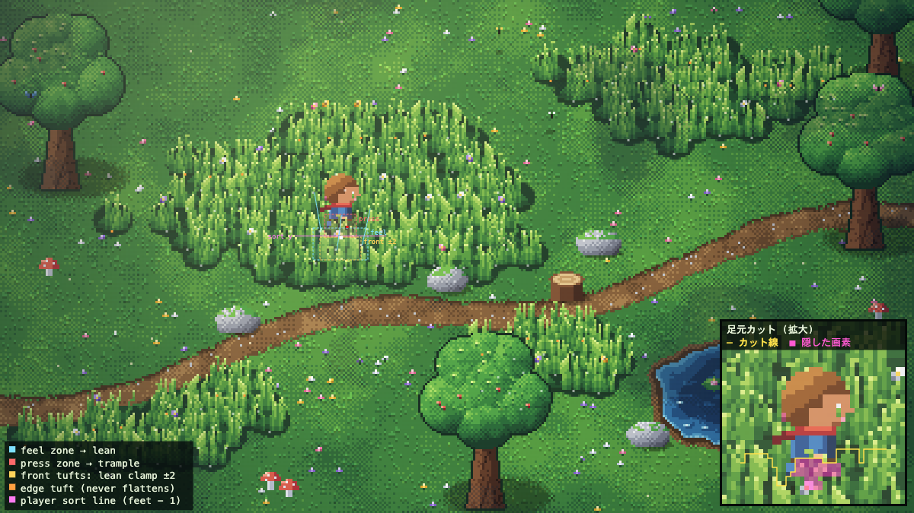

---

## 全体の仕組み

すべて CPU で処理しています（シェーダーなし）。物理は **60 Hz の固定ティック**、描画は `requestAnimationFrame` ごとです。

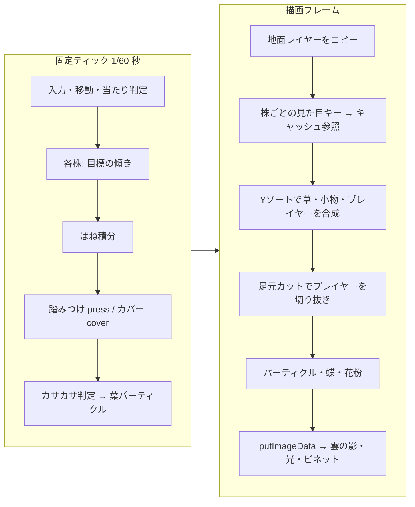

| 段階 | ファイル |
| --- | --- |
| 草のシミュレーションと見た目の生成 | [`src/grass.js`](src/grass.js) |
| 株のドット絵生成 | [`src/tufts.js`](src/tufts.js) |
| 足元カット | [`src/wade.js`](src/wade.js) |
| ゲームループ・Yソート・合成 | [`src/game.js`](src/game.js) |

---

## 1. 1株 = 1スプライト

草むらは1枚の絵ではなく、**16×18 px の小さな株（tuft）スプライトの集まり**です。原点は株の根元にあります。

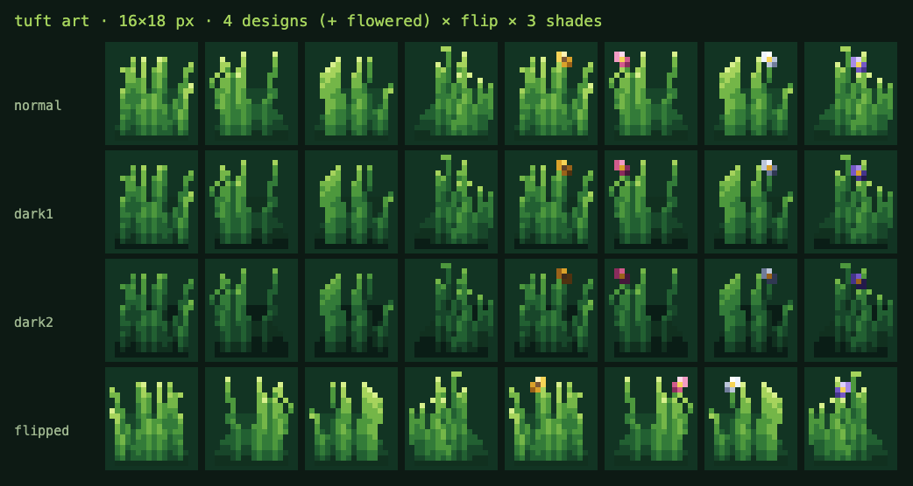

- **4つのデザイン**（＋花付きの4バリエーション）× **左右反転** × **3段階の濃さ**（normal / dark1 / dark2）。
- 色はすべて「カラーランプ（暗→明の色の並び）のインデックス」で塗っています。だから **dark1 / dark2 は全ピクセルをランプ上で1段・2段下げるだけ**で作れます（`darkenCode`）。
- **下から10行は穴なしで塗りつぶし**ます。株と株の隙間から地面が見えて、草むらがスカスカに見えるのを防ぐためです。
- 草むらの下の地面は **単色の濃い緑** です。株の隙間が「奥行き」に見えます。この地面は株の位置から逆算して、株の胴体の真下だけに塗っています。
- 株は約 **13 px × 8 px の千鳥格子** にジッターを加えて並べています。
- 背後に株がない **縁の株（edge）** はレイアウト時に印を付け、潰れないようにしています（潰れると草むらの外の地面が透けて見えてしまうため）。

各株の葉は、根元から先端へ向かう曲線として描きます（[`src/tufts.js`](src/tufts.js)）。根元は暗く、先端ほど明るくしています。左側を1段明るくして左上から光が当たっているように見せ、奥の葉から手前の葉の順に重ねています。

---

## 2. Yソートと sortOffset

株・木・岩・プレイヤーは **根元の y 座標** でソートして、奥から順に描きます。

- プレイヤーは **足元より 1 px 上にいるものとして** ソートします（`sortOffset = 1`）。そのため、足元と同じ高さに根元がある株はプレイヤーより手前に描かれます。
- 同じ値になったときはプレイヤーが後（手前）になります。
- 株と小物は静的なので最初に一度だけソートします。毎フレームの作業は、プレイヤーの挿入位置を探すことだけです。

ただし、Yソートだけでは **手前の株の隙間からプレイヤーの脚が見えてしまいます**。これを直すのが後で説明する [足元カット](#8-足元カットwading-cut) です。

---

## 3. 押しのけて傾く（ばね）

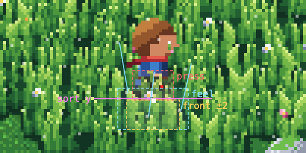

各ティックで、株の根元と足元の差を `dx = tuft.x − feet.x`、`dy = tuft.y − feet.y` とします。

**感知ゾーン**（水色）: `|dx| < 12` かつ `−4 < dy < 10`

```js
// ゾーンに入った瞬間に、どちらへ倒れるか (side) を決める。同点なら株ごとの乱数で決める
if (t.side === 0) t.side = dx > 0 ? 1 : dx < 0 ? -1 : t.phase > 0.5 ? 1 : -1;
target = side * 7 * min(1, (12 - |dx|) / 6) * min(1, (10 - |dy - 3|) / 5);
// 手前の株（黄色）は ±2 px までしか傾けない → 脚を隠し続ける
if (dy > -1 && |dx| < 9) target = clamp(target, -2, 2);
```

- `side` は **ゾーンを出たときにリセット** します。そのため、すれ違う途中で倒れる向きが逆になることはありません。
- 傾きは **減衰ばね** で目標値に近づけます（半陰的オイラー法）:

```js
const w = 2 * Math.PI * 2.6;                           // 2.6 Hz
const acc = w * w * (target - lean) - 2 * 0.22 * w * vel; // 減衰比 0.22
vel  += acc * dt;
lean  = clamp(lean + vel * dt, -8, 8);
```

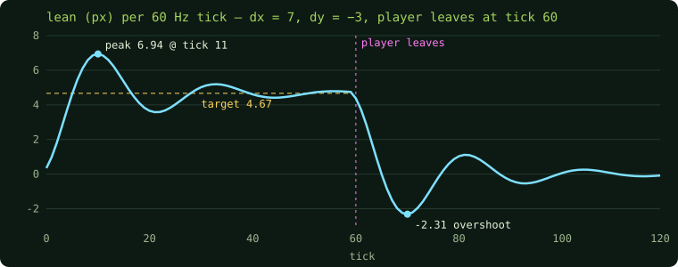

減衰比が低め（0.22）なので、ぐっと倒れて少し行き過ぎ、プレイヤーが去るとマイナス側へ跳ね返ってから元に戻ります。この揺れ方が「ぷるん」とした手触りになります。グラフは [`tools/plot.mjs`](tools/plot.mjs) が実際の `tickGrass()` を動かして描いています。

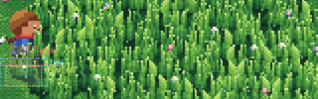

---

## 4. 行シフトで曲げる

傾きは「スプライトを回転させる」のではなく、**各行を整数ピクセル分だけ横にずらす**ことで表現しています。

```js
shift(r) = round(total * ((h - 1 - r) / (h - 1)) ** 1.6)   // r = 0 が先端、h-1 が根元
```

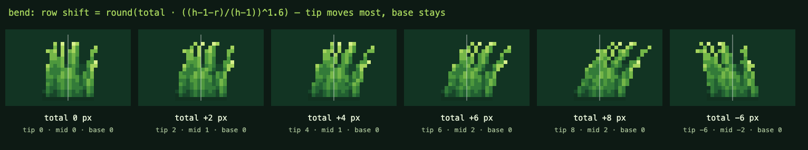

- 指数 1.6 のカーブにより、**先端ほど大きく動き、根元は動きません**。
- すべて整数に丸めるので、ドット絵がにじまず、くっきりしたままです。
- `total = lean + shake + wind`。`|total| < 0.5` のときはずらしません（静止している株の見た目が細かくちらつくのを防ぐため）。
- 出力画像は左右に `pad = ceil(|total|) + 1` の余白を付けて確保し、描画位置もその分ずらします。

---

## 5. 踏まれて潰れ、また伸びる

**踏みつけゾーン**（赤）: `|dx| < 7` かつ `−10 < dy ≤ −1`（＝プレイヤーの体の下にある株）。縁の株は対象外です。

```js
press += inZone ? dt / 0.12 : -dt / 0.7;    // 0.12 秒で潰れて 0.7 秒で戻る
h  = max(1, round(18 * (1 - 0.67 * smoothstep(press)) * (1 - 0.1 * cover)));
shade = press > 0.6 ? dark2 : press > 0.3 ? dark1 : normal;
```

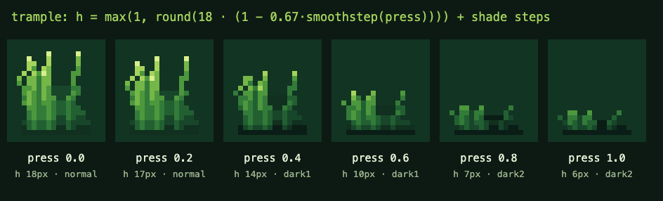

- 高さは 18 px から 6 px まで縮みます。行は `src = round(i * (18 - 1) / (h - 1))` で間引いて **リサンプリング** します。この式だと根元の行が必ず残ります。
- 潰れるほど暗いシェードに切り替わり、影になっているように見えます。
- 戻るまでの時間を **1秒未満** にしているので、暗い跡がいつまでも残ることはありません。

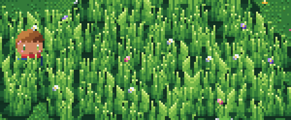

---

## 6. カバー（顔の前の草を少し縮める）

足元のすぐ手前にある株は、高さを最大 10% 縮めます。顔や胴体が草で隠れすぎないようにするためです。

```js
ddy  = dy + 1;
near = ddy > 0 ? clamp((11 - |dx|) / 3, 0, 1) * clamp((10 - ddy) / 3, 0, 1) * min(1, ddy / 3) : 0;
cover → near   // 変化の速さは 1/0.35 毎秒まで
```

---

## 7. カサカサ揺れとクールダウン

目標の傾きが `1.5 px` を超えて、前に揺れてから `0.7 秒` 以上経っていれば **カサカサ（rustle）** が発生します。

```js
shake = 1.3 * sin(age * 55 + phase * 6) * max(0, 1 - age / 0.35);   // age = now - touch
```

- 小刻みに 0.35 秒だけ震えて、明るい緑の葉の粒（パーティクル）が舞います（[`src/fx.js`](src/fx.js) の `Particles.rustle`）。
- 押し続けている間は `touch = max(touch, now − 0.5)` で **クールダウンを延長し続けます**。草むらの中に立っているだけで、揺れやパーティクルが出続けることはありません。

---

## 8. 足元カット（Wading cut）

Yソートだけでは、手前の株の **隙間** から脚が見えてしまいます。そこで、プレイヤーの現在のフレーム（32×32）を毎フレーム切り抜きます。

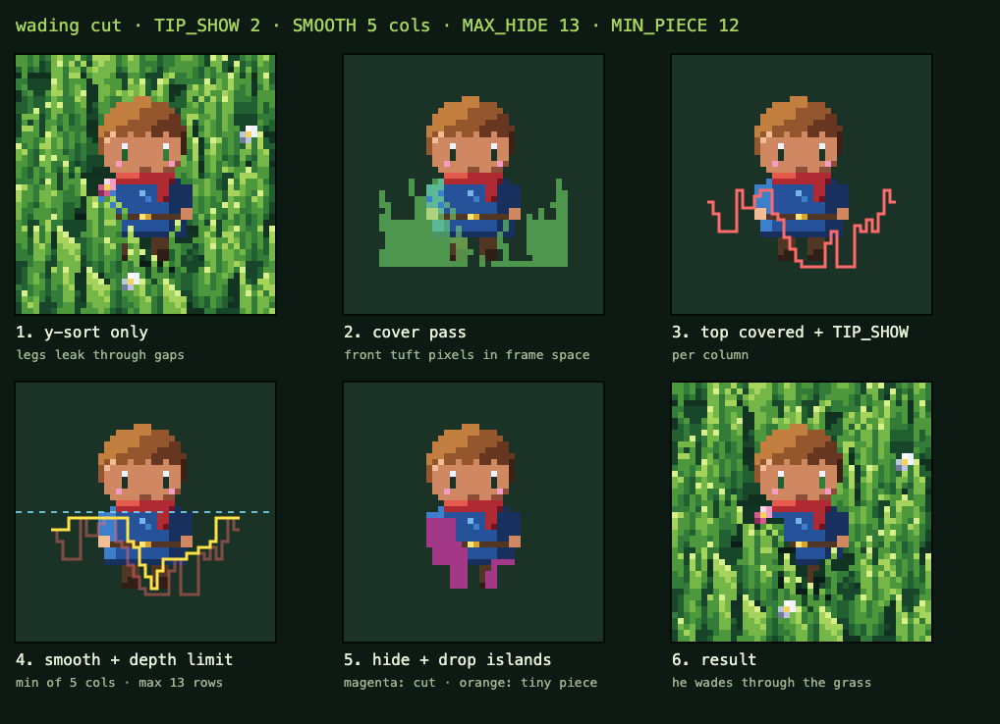

1. **カバーパス**: プレイヤーより手前にソートされる株（根元の y > 足元 − 1）について、**いま実際に描かれている株の画像**の不透明ピクセルを、プレイヤーのフレーム座標で塗りつぶしたマスクを作ります。
2. **列ごとの上端**: 列 `c` で一番上にある塗られた行に `TIP_SHOW = 2` を足した値を `cut[c]` にします。葉先の2行ぶんは体が見えるようにして、草の先端が体に重なって見えるようにします。
3. **スムージング**: `c−2 … c+2` の5列の最小値を取ります（端は鏡像で折り返します）。カット線のギザギザを抑えるためです。
4. **深さ制限**: 最下段の不透明行から `MAX_HIDE = 13` 行より上は隠しません。草が少ない場所で体まで消えるのを防ぐためです。
5. **隠して、島を消す**: `cut[c]` 以降の行を消します。そのあと残ったピクセルを8近傍で塗りつぶし探索し、`MIN_PIECE = 12` px 未満の小さな島は消します（隙間から見える数ピクセルの脚などのゴミ）。

カット線は **実際に描かれている株の形** から作るので、株が傾いたり潰れたりすると、カット線もそれに合わせて動きます。

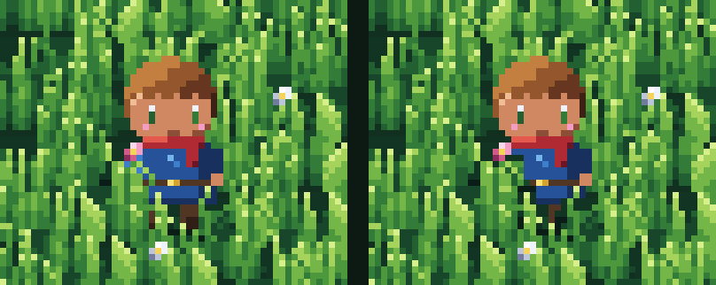

左: 足元カット OFF（Yソートのみ）だと脚が隙間から見えます。右: ON にすると脚が草に埋もれます。

> 実装: [`src/wade.js`](src/wade.js)。ゲーム中は `M` キーで拡大鏡を出すと、カット線（黄）と隠したピクセル（マゼンタ）がリアルタイムで見られます。

---

## 9. 見た目キャッシュ

記事の Godot 版は、株ごとに `"幅,高さ,画像データのハッシュ"` を見た目のキーにして、キーが変わったときだけテクスチャを作り直していました。

このリポジトリではさらに一歩進めて、**全株で共有するグローバルキャッシュ** にしています。

```js
key = artId * 100000 + h * 1000 + (total * 4 + 500)   // artId = デザイン × 反転 × シェード
```

- 見た目は（どの絵か・高さ・0.25 px 単位に量子化した曲がり量）だけで決まります。そのため、**同じ状態の株は同じ画像を使い回せます**。
- 約170株が風で揺れていても、ユニークな画像は数百枚程度です。静止している株は再構築コストがゼロです。
- 画面下のステータスバーに `looks cached`（キャッシュ数）と `built this frame`（このフレームで新しく作った数）を表示しています。

---

## 10. 風（このリポジトリ独自の拡張）

元記事には風はありません。ここでは、行シフトの `total` に風の項を足すだけで、ゆったりした揺れと **草むらを渡っていく突風の帯** を追加しています。

```js
sway = 0.55 * sin(t * 1.4 + x * 0.045 + y * 0.021);
gust = max(0, sin(x * 0.022 + y * 0.012 - t * 0.9)) ** 6 * 1.9;
wind = windPx * (sway + gust) * (1 - smoothstep(press));   // 潰れた株は揺れない
```

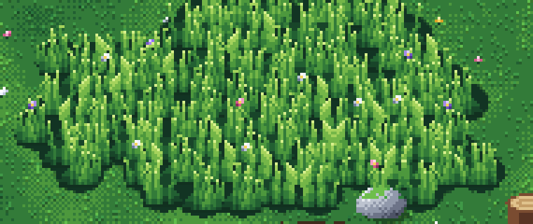

風も同じ行シフトとキャッシュの仕組みに乗っているので、追加のコストはほとんどありません。

---

## 11. ソフトウェアレンダラと光

- 画面は **400×225 の `Uint32Array` フレームバッファ** です。地面のコピー → スプライトの転送（`blit`）→ `putImageData` を1回、という流れで描画しています。Canvas の描画 API はほとんど使っていません。
- 表示するときは整数倍に拡大し（`image-rendering: pixelated`）、ドットをくっきり見せます。スマホのように画面が小さいときは等倍以下に縮めます。
- その上に Canvas 2D で次のような光のレイヤーを重ねています（`F` キーで ON/OFF）:
  - **流れる雲の影**（fbm ノイズを2段階のアルファ＋市松模様のディザで表現）
  - 左上からの **暖色の日差し** と **ビネット**
- 水面のきらめき、蝶（プレイヤーが近づくと逃げる）、木から落ちる葉、浮遊する花粉、土の道を歩くと出る砂ぼこりもあります。
- 影（木・岩・プレイヤー・蝶）は、楕円の内側の色を暗くし、縁を **Bayer 4×4 のオーダードディザ** でぼかしています。

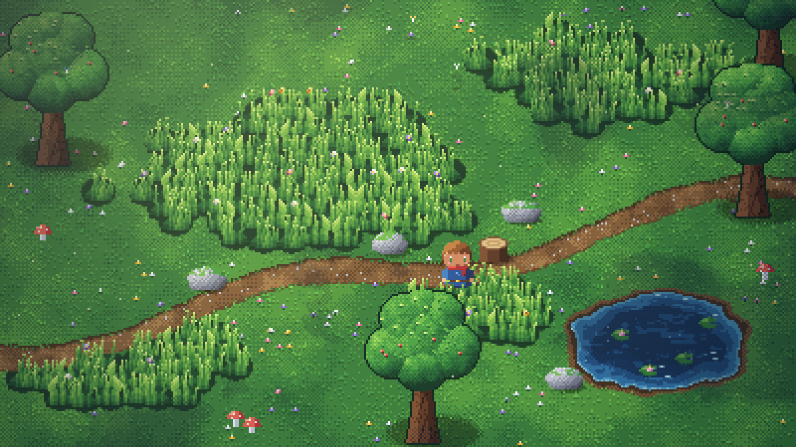

---

## 12. プロシージャルなアート

外部の画像ファイルは一切使っていません。すべて固定シード付きの乱数とノイズから生成しているので、毎回同じ景色になります。

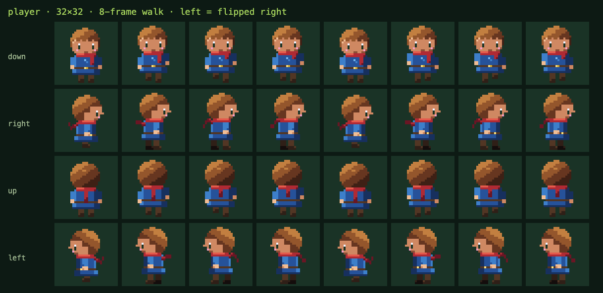

| アセット | 作り方 |
| --- | --- |
| 草の株 | 曲線の葉を奥から手前へ重ね、ランプのインデックスで陰影を付け、下10行を塗りつぶし、花を追加 |
| プレイヤー | 32×32 px。下・上・右向き × 8フレームの歩行と待機。左向きは右向きを反転。最後に外側へ1 px のアウトラインを自動で付ける |
| 木 | 複数の球を合成し、ランバート反射＋ノイズで陰影を付け、ディザで階調を表現。下側は影にする。リンゴと葉のハイライトを散らす |
| 地面 | fbm ノイズ＋ディザで草地の3段階の色を作り、短い草の線・クローバー・花を散らす。土の道・池（深さで色を変え、岸に泡）・スイレン |
| 岩・切り株・キノコ | 球のライティング＋苔＋アウトライン |

---

## パラメータ一覧

`P` キーのパネルで、実行中に変更できます。数値は記事と同じです。

| 名前 | 既定値 | 意味 |
| --- | --- | --- |
| `feelX / feelBack / feelFront` | 12 / 4 / 10 | 感知ゾーン（px） |
| `leanPx` | 7 | 最大の傾きの目標値 |
| `frontX / frontLeanPx` | 9 / 2 | 手前の株の傾きを制限する範囲と上限 |
| `maxLeanPx` | 8 | 傾きの絶対上限 |
| `springHz / damping` | 2.6 / 0.22 | ばねの固有振動数と減衰比 |
| `pressX / pressBack` | 7 / 10 | 踏みつけゾーン |
| `pressTime / recoverTime` | 0.12 / 0.7 | 潰れる時間・戻る時間（秒） |
| `pressSquash` | 0.67 | 潰れたときに縮む割合 |
| `coverTime / coverSquash` | 0.35 / 0.1 | カバーの変化速度と縮む割合 |
| `shakePx / shakeSpeed / shakeTime` | 1.3 / 55 / 0.35 | カサカサ揺れの振幅・速さ・長さ |
| `touchLean / touchCooldown` | 1.5 / 0.7 | カサカサが起きる傾きの閾値とクールダウン |
| `sortOffset` | 1 | プレイヤーのソート用オフセット |
| `windPx / windSpeed` | 1.0 / 1.0 | **拡張**: 風の強さと速さ |
| `TIP_SHOW / SMOOTH_COLUMNS / MAX_HIDE / MIN_PIECE` | 2 / 5 / 13 / 12 | 足元カットの定数 |

---

## 記事の数値との照合

[`tools/verify.mjs`](tools/verify.mjs) は記事に書かれているティック数のチェックを Node で再現します（`npm run verify`）。

```
PASS  lean peak ~6.9 px @ tick 11                  peak=6.94 @11
PASS  settles within 0.5 of 4.67 from tick 35      settle=35
PASS  overshoot ~-2.3 px after leaving             min=-2.27
PASS  back within 0.5 of 0 from tick 36 (±1)       back=35
PASS  fully flat (6 px) on tick 8 (±1)             flat=7
PASS  back to 18 px on tick 37                     grown=37
PASS  press = 0 on tick 42                         zero=42
```

2つの項目が1ティック早くなっています。記事は「新しい画像が表示されたティック」で数えており、物理のティックより1つ遅れることがあるためと考えられます。

---

## ファイル構成

```
index.html, style.css     UI（日本語 / 英語の切り替え、トグル、パラメータパネル）
src/main.js               入力・ループ・UI・決定的に1ティックずつ進める API (window.lab)
src/game.js               ゲーム状態・移動・Yソート・フレームの合成
src/grass.js              ★ 草の物理（傾き・踏みつけ・カバー・カサカサ）と見た目キャッシュ
src/wade.js               ★ 足元カット
src/tufts.js              株のドット絵の生成（デザイン × 反転 × シェード）
src/player.js             プレイヤーの歩行アニメの生成
src/world.js              地面・草むら・株の配置・木/岩などの小物・当たり判定
src/fx.js                 パーティクル・蝶・水面・花粉・光のレイヤー
src/raster.js             フレームバッファへの転送・影・アウトライン
src/palette.js            カラーランプ
src/debug.js              デバッグ表示と拡大鏡
src/figures.js            README の図（?fig=tufts|bend|trample|player|cut）
tools/verify.mjs          記事の数値との照合
tools/capture.mjs         README の画像・GIF を自動生成（headless Chrome）
tools/plot.mjs            ばねの応答グラフ (SVG)
```

README の図や GIF は、すべてゲーム本体と同じコードから自動で生成しています。手描きの図はありません。

---

## ローカルで動かす

ビルドは不要です。ES Modules を使っているので、静的サーバーで配信してください。

```bash
python3 -m http.server 8765
```

http://localhost:8765/ を開きます。

README の画像を作り直す場合（Google Chrome と Python の Pillow が必要です）:

```bash
npm install
```

```bash
npm run capture
```

## クレジット

- 技術の出典: [SpriteCook — How to make interactive tall grass for a top-down pixel art game](https://www.spritecook.ai/blog/interactive-tall-grass-top-down-pixel-art)。数値やアルゴリズムは記事に準拠し、コードは JavaScript で独自に書き直しています。
- アートはすべてこのリポジトリのコードで生成しています。
